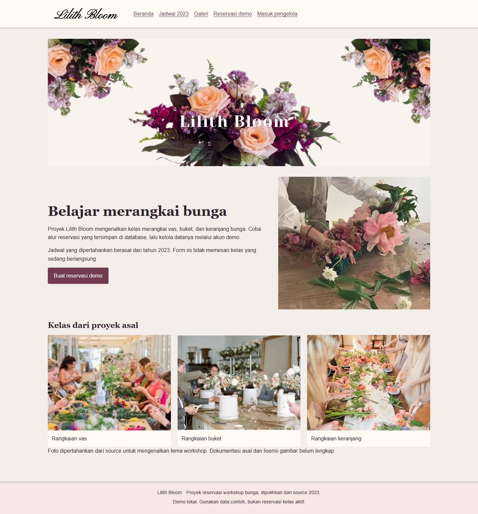
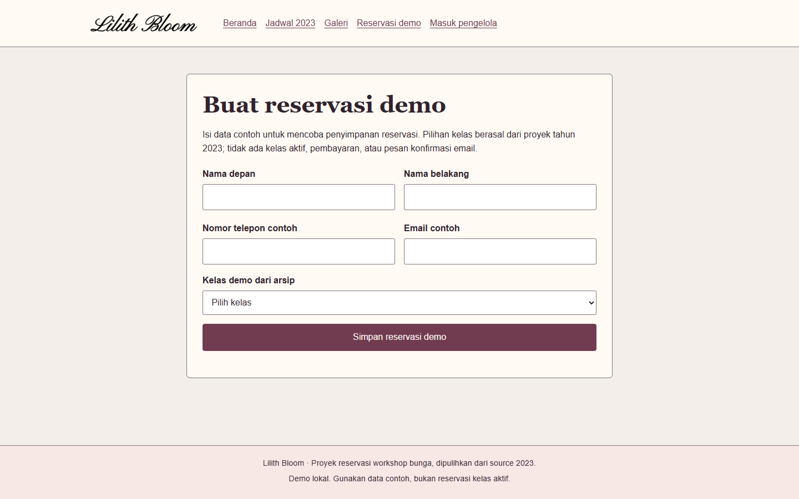

# Lilith Bloom

Proyek latihan **reservasi workshop merangkai bunga** dengan Java 17, JSF/Facelets, Hibernate, dan MySQL. Pengunjung menyimpan reservasi demo; pengelola yang sudah masuk dapat mencari, mengedit, atau menghapus data tersebut.

Jadwal dan gambar dipertahankan dari proyek tahun 2023. Ini demo lokal dengan data contoh, bukan layanan pemesanan kelas aktif. Tidak ada pembayaran, kuota kelas, email konfirmasi, atau verifikasi akun. Semua akun pengelola demo memiliki hak akses yang sama.

## Tampilan aplikasi



Tangkapan aplikasi dari pengujian 25 Oktober 2026. Form masih kosong; pengujian reservasi memakai data sintetis. Perbaikan backend setelah pengambilan gambar tidak mengubah UI ini.

<details>
<summary>Form reservasi demo</summary>



</details>

## Jalankan dengan Docker

Siapkan Docker Desktop dengan Linux containers dan Docker Compose. Dari PowerShell:

```powershell
git clone https://github.com/zalamanga/lilith-bloom.git
cd lilith-bloom
Copy-Item .env.example .env
```

Buka `.env`, isi `DB_PASSWORD` dengan password database demo lokal pilihanmu, lalu jalankan:

```powershell
docker compose up --build -d
docker compose ps
```

Buka **http://localhost:18096** setelah database berstatus `healthy` dan Tomcat selesai memulai. Build pertama mengunduh image serta dependency Maven. Di Linux/macOS gunakan `cp .env.example .env`.

Database baru tidak berisi akun atau reservasi. Pilih **Reservasi demo**, gunakan nama contoh, email seperti `demo@example.test`, dan nomor telepon contoh. Setelah penyimpanan berhasil, halaman konfirmasi menampilkan nomor reservasi dari database. Nomor ini bukan tiket atau bukti pembayaran.

Untuk mengelola data, pilih **Masuk pengelola**, lalu **Buat akun pengelola demo**. Password harus 12 sampai 128 karakter. Setelah masuk, halaman **Kelola reservasi** menampilkan data yang tadi disimpan. Gunakan data sintetis karena setiap akun demo dapat melihat dan mengubah semua reservasi.

```powershell
docker compose logs --tail=60 web
docker compose down
```

`down` mempertahankan volume database. MySQL tidak membuka port ke host; web hanya diikat ke loopback komputer lokal. Mengedit SQL init hanya berlaku saat volume baru dibuat. Mengganti password dalam `.env` tidak otomatis mengubah password pengguna MySQL yang sudah tersimpan.

## Fitur dan batasannya

- **Reservasi:** nama depan/belakang, telepon, email, dan satu dari tujuh pilihan kelas asal. Server memvalidasi seluruh isian dan memastikan kelas berada dalam daftar yang diizinkan.
- **Pengelolaan:** cari nama, email, atau kelas; pilih Edit lalu simpan atau batalkan. Perubahan dari halaman lama ditolak bila versi data sudah berubah.
- **Hapus:** konfirmasi menampilkan nama pemesan sebelum penghapusan. Hapus benar-benar mengubah database; Batal hapus mempertahankan data.
- **Akun:** password disimpan sebagai hash PBKDF2-HMAC-SHA256 dengan salt acak. Login mengganti ID sesi; halaman pengelolaan memerlukan sesi. Keluar mengirim POST dan mengakhiri sesi server.
- **Arsip jadwal:** 40 agenda asli dari 12 bulan pada tahun 2023 ditampilkan sebagai bahan proyek historis, tanpa mengklaim tanggal atau ketersediaan baru.
- **Galeri:** foto source lama dipertahankan dengan keterangan referensi. Beberapa foto menunjukkan merek toko lain; halaman ini tidak mengklaimnya sebagai cabang Lilith Bloom.

Form perubahan memakai token CSRF sesi dan view state JSF. Sesi berakhir setelah 30 menit tidak aktif. Lima kegagalan login memberi jeda 30 detik pada sesi tersebut. Mekanisme ini tidak menyediakan otorisasi peran, pembatasan lintas sesi, ataupun moderasi reservasi publik.

## Struktur dan build

```text
database/001-schema.sql           Skema kosong untuk akun dan reservasi demo
src/main/java/com/lilithbloom/    Hibernate, layanan data, password, sesi/CSRF
src/main/java/.../model/          Entitas Account dan Reservation
src/main/java/.../web/            Managed bean JSF
src/main/resources/              Arsip jadwal 2023 dari tabel source asal
src/main/webapp/                 Facelets, CSS/JS lokal, dan gambar sumber
src/test/java/                   Tes password/CSRF dan integrasi ORM H2 terisolasi
pom.xml                          Build Maven menjadi WAR
Dockerfile / compose.yaml        Tomcat 9 dan MySQL 8.4
```

Dengan JDK 17 dan Maven 3.9:

```powershell
mvn verify
```

Hasil build adalah `target/lilith-bloom.war`. Untuk deploy tanpa Docker, siapkan MySQL menggunakan `database/001-schema.sql`, lalu atur `DB_URL`, `DB_USER`, dan `DB_PASSWORD` pada **proses Tomcat 9**. Contoh URL: `jdbc:mysql://localhost:3306/lilith_bloom?serverTimezone=UTC`. Dengan nama WAR dan port default tersebut, buka `http://localhost:8080/lilith-bloom/`. File `.env` hanya dibaca Compose, tidak otomatis dibaca Tomcat mandiri.

Mojarra 2.3.21 memakai artifact `org.glassfish:jakarta.faces` tetapi masih memakai namespace `javax.faces`; Tomcat 10/11 memerlukan migrasi. Hibernate 5.6 dipertahankan dekat dengan stack asal. Ini pemulihan demo stack lama, tanpa klaim siap produksi atau telah diaudit untuk penerapan publik.

[Alur kode dan diagram](docs/CODE_FLOW.md) menjelaskan reservasi publik, konfirmasi penyimpanan, akun pengelola, versi record, dan arsip jadwal.

## Jika ada masalah

- **Port dipakai:** ubah `APP_PORT` dalam `.env`, kemudian jalankan `docker compose up -d`.
- **Database belum tersedia:** periksa status dan log Docker serta konfigurasi pengguna. Daftar menyediakan tombol **Muat ulang**; koneksi yang sudah putus dibuang agar permintaan berikutnya dapat membuka pool baru. Aplikasi tidak mengirim ulang transaksi tulis secara otomatis. Jika koneksi putus saat menyimpan reservasi, periksa daftar melalui pengelola sebelum mengirim ulang, karena hasil pengiriman sebelumnya mungkin belum dapat dikonfirmasi.
- **Form kedaluwarsa / 403:** buka ulang halaman dan gunakan form baru, terutama setelah keluar atau berpindah sesi.
- **Daftar kosong:** database baru memang kosong. Buat reservasi demo; bila memakai pencarian, pilih **Tampilkan semua**.
- **Perubahan ditolak:** data mungkin telah diedit atau dihapus dari tab lain. Muat ulang daftar sebelum mengedit kembali.

Tes lama tidak dijalankan atau disalin karena dapat menyentuh database asal. Tes Maven baru menggunakan H2 dalam memori dan data sintetis; tidak memerlukan database pengguna.

## Asal dan aset

Dipulihkan dari `LilithBloom`, proyek JSF/Hibernate yang mencantumkan **aulia maulidia** pada source DAO dan **Lilith Bloom, 2023** pada halaman asal. Perbaikan memisahkan model dari managed bean, memulihkan binding edit, menghapus entitas yang benar, menutup sesi Hibernate, dan mengganti konfigurasi database hardcoded dengan environment.

Ke-23 gambar asli disimpan identik. Asal serta lisensi per gambar belum tercatat lengkap. Foto etalase memuat merek lain, sehingga keterangan galeri tidak mengklaimnya sebagai usaha pemilik repo. Repo ini tidak memberi lisensi menyeluruh baru atas source dan aset yang asal izinnya belum tercatat. Data akun/database, konfigurasi IDE privat, hasil build, dan laporan lama tidak dimasukkan.
