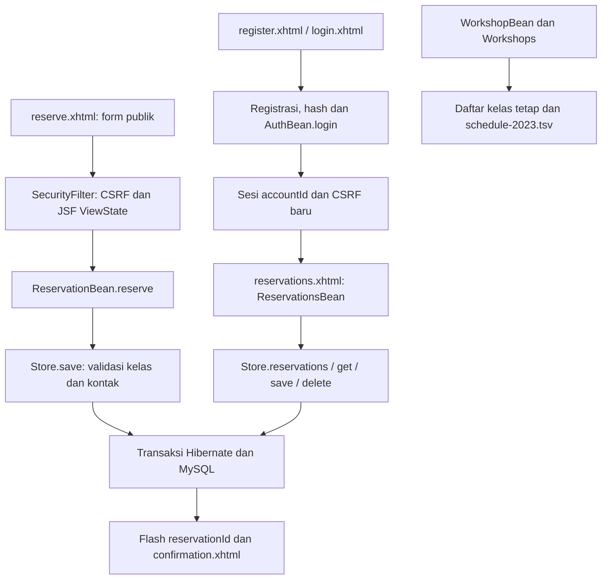

# Alur kode Lilith Bloom

Pengunjung mengirim reservasi workshop demo tanpa harus login. Pengelola yang terdaftar dapat membaca dan mengubah seluruh reservasi. Entitas reservasi tidak memiliki pemilik akun; ini bukan daftar pemesanan pribadi per pengguna. Jadwal 2023 adalah arsip, tanpa kuota kelas aktif, pembayaran, atau email konfirmasi.

## Reservasi publik

[`reserve.xhtml`](../src/main/webapp/reserve.xhtml) mengikat isian ke bean `booking`: nama depan/belakang, telepon, email, dan pilihan workshop. [`ReservationBean.reserve()`](../src/main/java/com/lilithbloom/web/ReservationBean.java) memanggil [`Store.save()`](../src/main/java/com/lilithbloom/Store.java) dengan ID kosong. Store memeriksa teks, email, pola telepon, serta keanggotaan kelas dalam `Workshops.OPTIONS` sebelum insert.

Setelah transaksi selesai, ID hasil database dimasukkan ke flash scope dan browser diarahkan ke [`confirmation.xhtml`](../src/main/webapp/confirmation.xhtml). Halaman tersebut hanya menampilkan hasil penyimpanan yang baru dilakukan. Membuka URL konfirmasi langsung tidak membuat reservasi dan tidak mengambil data pemesan berdasarkan ID bebas.

Permintaan baru selalu membuat reservasi baru. Tidak ada token deduplikasi bisnis atau pemeriksaan reservasi ganda; ketika hasil simpan tidak pasti, pengguna diminta memeriksa daftar melalui pengelola sebelum mengirim ulang.

## Akun dan pengelolaan bersama

Registrasi menyimpan akun dengan hash `Passwords`, kemudian mengarahkan ke login. [`AuthBean.login()`](../src/main/java/com/lilithbloom/web/AuthBean.java) memverifikasi akun, mengganti ID sesi dan token CSRF, serta menyimpan `accountId`. Lima respons kredensial tidak cocok memicu jeda 30 detik pada sesi itu saja. Tidak ada pemisahan peran atau pembatasan login lintas sesi.

[`SecurityFilter`](../src/main/java/com/lilithbloom/SecurityFilter.java) mewajibkan sesi untuk `reservations.xhtml` dan `/logout`. POST non-resource memerlukan token CSRF; form Facelets juga memerlukan JSF ViewState. Keluar memakai POST `LogoutServlet` dan membatalkan sesi.

[`ReservationsBean`](../src/main/java/com/lilithbloom/web/ReservationsBean.java) memuat daftar melalui `reload()`, dengan pencarian nama, email, atau kelas. `edit()` mengambil record dan versinya; `save()` hanya mengubah reservasi yang sudah dipilih. `askDelete()` menyimpan ID/versi/nama untuk konfirmasi, `cancelDelete()` membatalkan, dan `delete()` meneruskan ID/versi ke store. Semua pengelola demo mempunyai akses pada daftar yang sama.

## Transaksi, versi, dan arsip

`Store.transaction()` membuka Session dan transaksi Hibernate, mengembalikan hasil setelah commit, mencoba rollback saat gagal, dan menutup Session. [`Reservation`](../src/main/java/com/lilithbloom/model/Reservation.java) mempunyai `@Version`; edit/hapus memeriksa versi yang dibaca sebelumnya, sehingga halaman lama tidak diam-diam menimpa perubahan baru.

Kegagalan koneksi membuang SessionFactory yang gagal melalui `Database.invalidate()`. Permintaan berikutnya dapat membuat koneksi baru; transaksi tulis tidak dikirim ulang otomatis. `Lifecycle` menutup factory ketika aplikasi berhenti. Schema baru disiapkan oleh [`database/001-schema.sql`](../database/001-schema.sql), bukan reset tabel pada setiap startup.

[`WorkshopBean`](../src/main/java/com/lilithbloom/web/WorkshopBean.java) memaparkan pilihan kelas tetap dan [`Workshops.archive()`](../src/main/java/com/lilithbloom/Workshops.java). Arsip dibaca dari [`schedule-2023.tsv`](../src/main/resources/schedule-2023.tsv), terpisah dari tabel reservasi. Menambah reservasi tidak mengurangi kuota atau mengubah agenda tersebut.
